# 模块目录、数据结构与接口

代码内使用 Rustdoc / JSDoc 说明参数、所有权、边界和错误语义。本文区分已运行的代码与
后续填充的接口；后者使用 trait 或文档契约，没有返回假成功的占位实现。

## 目录职责

```text
sender/
  index.html                  自动循环发送页面（静态、无构建）
  protocol/codec.js           VMT1/VMT2 头部、元数据、CRC、按颜色模式打包/解包
  render/canvas.js            固定视觉布局 → RGBA → Canvas
  session/transfer.js         FileReader 适配、分块哈希、按需取块、循环帧顺序
  player/contracts.js         播放器类型和函数契约
  player/player.js            单调时钟调度、循环、预读、暂停/停止和本地计时
  ui/app.js, style.css        文件选择、准备/播放状态、取消、异步代次保护
  vendor/                    js-sha256 0.11.1、来源和许可证
receiver/
  Cargo.toml, Cargo.lock      锁定 Rust 依赖
  src/lib.rs                 纯接收库入口
  build.rs                   仅 live-capture 编译小型 C 桥接
  src/main.rs                decode / snapshot / receive CLI 驱动
  src/protocol/mod.rs        有界二进制解析、ValidatedFrame
  src/codec/
    bitmap.rs               像素格式、stride、借用缓冲区验证
    locator.rs              三定位标记 → GridTransform
    palette.rs              参考色块 → 归一化分类
    mod.rs                  公共 decode_bitmap 入口
  src/session/mod.rs         会话状态机、位图去重、冲突处理
  src/storage/mod.rs         临时文件、流式哈希、原子禁止覆盖保存
  src/metrics.rs             计数器和时间快照
  src/error.rs               可丢弃帧错误与致命错误
  src/capture/
    mod.rs                  FrameSource / CapturedFrame
    png.rs                  PNG 输入和诊断截图导出
    portal.rs               授权契约、错误类型、可选 PortalCapture 导出
    dbus.rs                 zbus Portal 请求/响应、会话与授权 FD
    live.rs                 PortalCapture、最新帧队列和资源生命周期
    video.rs                有界像素格式、stride、offset 和 crop 转换
    pw_bridge.c             系统 PipeWire C ABI；不含协议或文件逻辑
  src/ui/mod.rs              原生进度展示契约（待实现）
  tests/offline.rs           协议、PNG、收集、安全保存的集成测试
protocol/
  SPEC.md                    唯一规范文本
  vectors/                   独立生成的输入、帧、PNG、cases.json
tests/
  generate-vectors.py         独立 Python 参考编码器
  js/codec.test.cjs           JS 单元/向量/浏览器全局路径测试
  js/player.test.cjs          可控时钟、循环稳定性、取消与错误测试
  js/ui.test.cjs              页面按钮、状态与换文件的竞态测试
  fake-clock.cjs              测试时钟，模拟后台/事件循环暂停
  image-tools.cjs             测试 PNG 写入与确定性图像扰动
  e2e.cjs                    编码器/自动播放器 → PNG → Rust → 精确字节比较
  browser-smoke.html          真实浏览器 Canvas 验证入口
docs/                        设计、环境、验收、基准记录
```

## 数据流与依赖方向

```mermaid
flowchart LR
    A[ByteSource / File] --> B[PreparedTransfer]
    B --> C[profile-sized frame]
    C --> D[RGBA / Canvas]
    D --> E[测试 PNG 或未来 VNC 像素]
    E --> F[BitmapView]
    F --> G[定位 / 采样 / 调色板 / CRC]
    G --> H[ValidatedFrame]
    H --> I[ReceiveSession]
    I --> J[临时文件 / 长度与 SHA 验证]
    J --> K[原子发布]
```



协议层不依赖图像、文件系统、采集或 UI；图像层不依赖收集器。PNG 清单只能列出路径与
顺序，不能提供 transfer ID、文件名、SHA 或矩阵坐标。后续 Portal 接入不能建立另一套解码逻辑。

## 发送端类型和函数

| 类型 / 函数 | 契约 |
|---|---|
| `Metadata` | `id: Uint8Array(16)`, `fileSize: number`, `name: string`, `sha256: Uint8Array(32)`；按准备完成后的只读值使用 |
| `ByteSource` | `name`, `size`, `readAt(offset, length, signal?) → Promise<Uint8Array>`；只读本地输入，必须精确返回指定长度 |
| `PreparedTransfer` | `metadata`, `metadataFrame`, `totalBlocks`, `readFrame(index, signal?)`；仅保留小型会话信息，不保留整套图像 |
| `prepareTransfer(source, options?)` | 返回 `Promise<PreparedTransfer>`；哈希完成前不播放；1 MiB 分块；取消抛 `AbortError` |
| `encodeMetadata(meta)` | 按矩阵尺寸与颜色模式生成固定长度规范帧；验证文件大小、UTF-8 名称和 ID/digest 长度 |
| `encodeData(meta, index, payload)` | 验证该块精确长度，补零并写 CRC；输入数据不压缩 |
| `packSymbols(bytes)` / `unpackSymbols(symbols)` | 纯函数，高位在前，拒绝白色数据符号 |
| `renderFrame(bytes, scale)` | 返回 `{width,height,stride,data}`，RGBA8，逻辑布局固定 |
| `drawCanvas(canvas, bitmap)` | 一次写入完整 Canvas；不承诺 VNC 以原子方式交付 |
| `cycleFrames(totalBlocks)` | 每组 64 个数据块前提供元数据描述；循环次数不进入线格式 |

`options.id` 只用于固定测试；实际页面由 `crypto.getRandomValues` 生成新 ID。
浏览器用全局 `VMT.codec/render/transfer`，Node 使用 CommonJS；核心实现相同。

## 接收端关键结构体和函数

| 类型 / 函数 | 字段与语义 |
|---|---|
| `FrameHeader` | `kind`, `color_mode`, `[u8;16] transfer_id`, `u32 block_index/total_blocks/payload_len` |
| `Metadata` | `u64 file_size`, `u32 block_size`, `[u8;32] sha256`, `String filename`；只有解析后值可进入会话 |
| `ValidatedFrame` | 字段私有，只能由解析器构造；getter 提供不可变头部、载荷和元数据 |
| `BitmapView<'a>` | 借用像素，显式 width/height/stride/PixelFormat；构造时验证所有缓冲区边界 |
| `GridTransform` | origin、x_axis、y_axis；将固定逻辑中心映射到实际像素 |
| `CapturedFrame` | 拥有 `Bitmap`，可选相对单调时间戳；PNG 无时间戳 |
| `ReceiveSession` | 会话 ID、元数据、按 u64 打包的到达位图、临时文件、计数器和终态 |
| `OutputFile` | 自己拥有临时文件；Drop 清理；publish 消耗所有权，不能再次发布 |
| `MetricsSnapshot<'a>` | 计数器引用、耗时、唯一块/秒、有效字节/秒；离线值不代表 VNC |

```rust
pub fn parse_frame(bytes: &[u8]) -> Result<ValidatedFrame>;
pub fn decode_bitmap(image: BitmapView<'_>) -> Result<ValidatedFrame>;
pub fn load_png(path: &Path) -> Result<Bitmap>;

impl ReceiveSession {
    pub fn new(output_directory: &Path) -> Self;
    pub fn ingest(&mut self, frame: &ValidatedFrame) -> Result<SessionEvent>;
    pub fn state(&self) -> &ReceiveState;
    pub fn is_consuming(&self) -> bool;
}
```

状态转换：`WaitingMetadata → Collecting → Verifying → Complete`；空文件初始化后直接验证。
冲突、哈希失败或 I/O 错误进入 `Failed`。完成后再次 ingest 返回 `AlreadyComplete`，调用方必须停止拉帧。
无效图像/CRC 不进入收集器；不兼容数据帧丢弃并计数；不同 ID 明确返回 `ForeignTransfer`。

内存上限：帧由预定义矩阵与颜色模式决定，最大为 RGB888 1028×512 的 1579008 字节；
1 GiB 文件最多 542294 块（128×128、2 色），存在位图不足 67800 字节。
PNG 最多 32 Mi 像素、单边最多 8192；输入 PNG 最多 128 MiB。定位器最多 16384 次纵向检查、
64 个 finder、16 个候选网格。低置信度或超过预算的图像丢弃，等待后续循环。

## 播放器与后续模块接口

`sender/player/contracts.js` 定义 `TargetFps`、`PlaybackState`、`PlaybackProgress`、`FramePlayer`，
由 player.js 实现以下工厂与控制接口：

```text
createPlayer(transfer, canvas, onProgress, {fps?, scale?}?) → FramePlayer
FramePlayer.start() → Promise<void>
FramePlayer.pause() / stop() / setRate(fps) / setScale(pixels)
FramePlayer.getProgress() → PlaybackProgress
```

使用 performance.now() 单调期限和 setTimeout，保留当前编码帧并最多预读一个编码帧。
只有实际展示后才推进迭代器；暂停取消预读但保留下一帧位置，停止清空图像并复位循环。
回调延迟后只推进一帧，重新等待完整间隔；不追赶连跳、不跳过数据块。结束后自动重启同一序列。
目标速率限定 5/10/15/20/25/30；统计最近最多 32 次逻辑帧展示及间隔，不能把它称作接收帧率。
getProgress 的 frameIndex 为包含元数据的 0-based 周期位置，loop 从 1 开始；首次展示前分别为 null/0。
scale-only 重绘不推进帧序列或展示计数。start 的 Promise 在调度启动后完成，后续错误经状态回调通知。
错误为当前播放器终态，需重新准备文件；暂停/停止不会生成新 ID。UI 在新文件和旧异步结果之间还有独立代次保护。

Rust 已编译的扩展契约：

```rust
pub trait FrameSource {
    fn next_frame(&mut self) -> Result<Option<CapturedFrame>>;
    fn stop(&mut self) -> Result<()>;
}
pub trait AuthorizedCapture: FrameSource + Sized {
    async fn authorize(target: CaptureTarget) -> Result<Self, CaptureFailure>;
}
pub trait ProgressView {
    fn render(&mut self, state: &ReceiveState, metrics: &MetricsSnapshot<'_>);
    fn capture_failure(&mut self, error: &CaptureFailure);
}
```

上面的授权错误结果使用标准库双参数 `Result`，其余使用本项目单参数 `Result`。
`live-capture` feature 已在 `capture/live.rs` 实现具体适配器：Portal 授权 → PipeWire FD → 有界最新帧队列。
不得在 PipeWire 回调中执行长时间解码、哈希或 UI 更新；复制/借用的缓冲区生命周期须明确。
新尺寸、格式、stride、裁剪信息只在适配层处理，统一生成 `BitmapView` 后走现有路径。
适配器已编译/组件测试通过；用户在 GNOME 桌面终端完成连续接收，恢复 40/40 块并验证文件 SHA-256。实际 Windows 7 / VNC 链路仍待验收。


### 七档矩阵接口

`codec.PROFILES` / Rust `protocol::PROFILES` 定义 profile 1–7，矩阵尺寸为 128×128、160×160、256×256、512×512、1028×512、512×256、256×128，
有效载荷为 4028、6332、16316、65468、131516、32700、8124 字节。`prepareTransfer(source, {matrixSize})` 决定本次文件的分块；
PreparedTransfer 携带 matrixSize，播放器只改变物理 scale，不在循环中更改矩阵。
`renderFrame` 按头部几何 profile、版本和颜色模式选择预定义布局。GridTransform 携带候选几何 profile；
解码器先读固定黑白引导条，再验证它与 CRC 覆盖的头部一致。
ReceiveSession 按已验证元数据 block_size 计算磁盘偏移并拒绝不同 profile 的数据。
